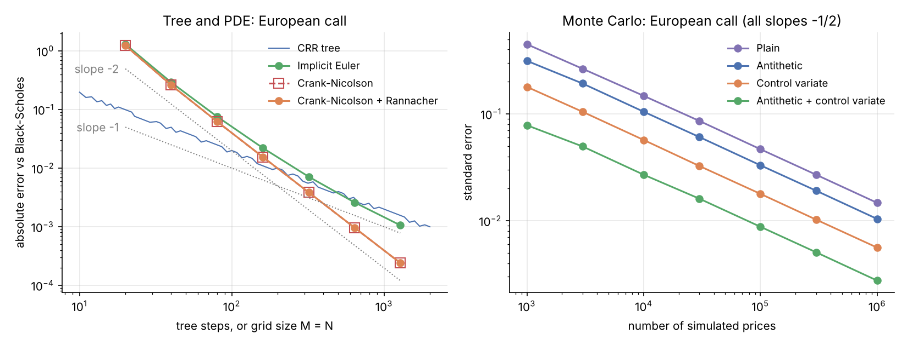
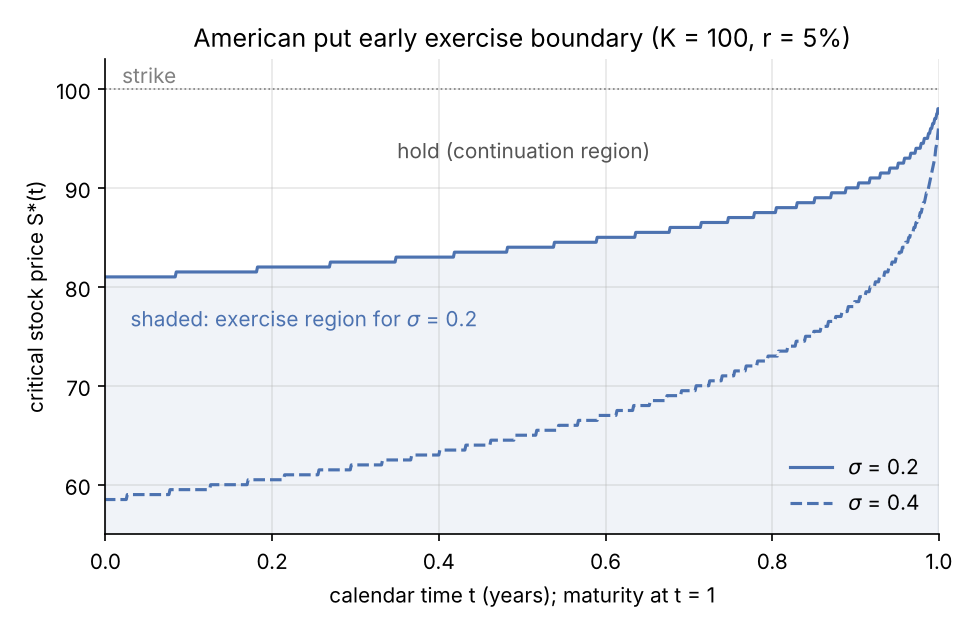
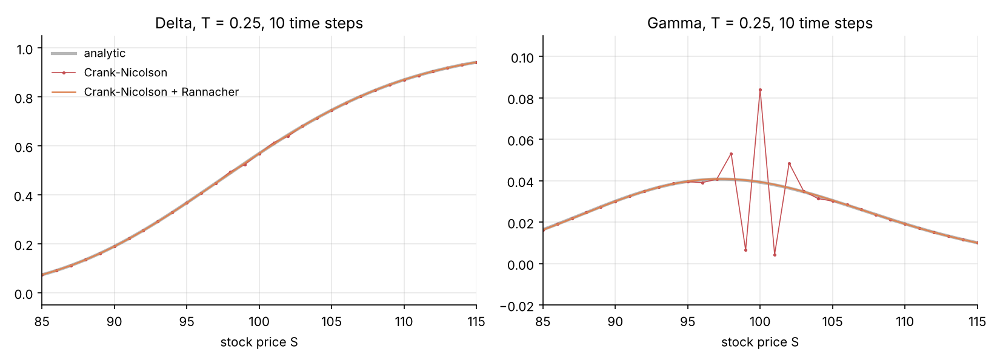

# Option Pricing Methods

A small Python library that prices European, American and Asian options four ways (Black-Scholes closed form, a Cox-Ross-Rubinstein binomial tree, finite differences for the Black-Scholes PDE, and Monte Carlo with variance reduction) and checks them against each other.

The goal is to understand the trade-offs: how fast each method converges, what goes wrong and why, and what the standard fixes (Rannacher smoothing, PSOR, antithetic and control variates) actually buy.



## Highlights

* All four methods agree on a European call to within 0.003 of the closed form, and the tree and PDE solver both land within about 0.003 of the American put reference (6.0904).
* Measured convergence orders match theory: **1.00** for the binomial tree, **2.04** for Crank-Nicolson, **0.50** for Monte Carlo.
* A geometric-average control variate cuts the variance of an arithmetic Asian option estimate by a factor of about **1,270**.
* Rannacher time stepping removes the spurious gamma oscillations that plain Crank-Nicolson produces near the strike, reducing the maximum gamma error by about **290x**.
* 83 passing unit tests (pytest), and every number below is reproducible from one script with fixed seeds.

## What's inside

| File | Contents |
|---|---|
| `pricing/black_scholes.py` | Closed-form price, all five Greeks, implied volatility (Brent's method with no-arbitrage checks) |
| `pricing/binomial.py` | CRR tree, European and American, with dividend yield |
| `pricing/finite_difference.py` | Theta scheme (explicit, implicit, Crank-Nicolson), Rannacher smoothing, PSOR for American options, grid Greeks, early exercise boundary |
| `pricing/monte_carlo.py` | European and Asian options, antithetic variates, control variates, closed-form geometric Asian price |
| `experiments/run_experiments.py` | Reproduces every table and figure below |
| `tests/` | Known values, put-call parity, Greeks vs bump-and-revalue, cross-method agreement, convergence order |

## Results

Base case: S0 = 100, K = 100, T = 1 year, r = 5%, σ = 20%, no dividends. Full output in [`results/results.md`](results/results.md). Times were measured on one CPU core of a cloud VM and will differ on your machine.

### One option, four methods

| Method | European call | European put | American put | Time (call) |
|---|---|---|---|---|
| Black-Scholes closed form | 10.4506 | 5.5735 | n/a | 0.07 ms |
| CRR tree, 1,000 steps | 10.4486 | 5.5715 | 6.0896 | 3 ms |
| Crank-Nicolson + Rannacher, 400 x 400 grid (PSOR for American) | 10.4481 | 5.5711 | 6.0874 | 23 ms |
| Monte Carlo, 1M paths, antithetic + control variate | 10.4484 (SE 0.0028) | 5.5714 (SE 0.0028) | n/a | 18 ms |
| Reference | 10.4506 | 5.5735 | 6.0904 | |

The American reference is the average of 20,000 and 20,001 step trees, which cancels the odd/even oscillation of the tree.

### Convergence

| Method | Error, coarsest | Error, finest | Empirical order |
|---|---|---|---|
| CRR tree (10 to 2,000 steps) | 2.0e-1 | 1.0e-3 | 1.00 |
| Crank-Nicolson + Rannacher (M = N = 20 to 1,280) | 1.2e+0 | 2.4e-4 | 2.04 |
| Implicit Euler (M = N = 20 to 1,280) | 1.3e+0 | 1.1e-3 | 1.71 |
| Monte Carlo standard error (1k to 1M paths) | 4.5e-1 | 1.5e-2 | 0.50 |

The empirical order is the slope of log(error) against log(steps). Implicit Euler's 1.71 is a mix: on coarse grids its second-order space error dominates, on fine grids its first-order time error takes over. Between the two finest grids (640 and 1,280) its error falls by 2.46x, against 4.00x for Crank-Nicolson.

The tree error zigzags because the strike sits at a different position relative to the terminal nodes as the number of steps changes between odd and even.

### Variance reduction (100,000 paths, seed 42)

Variance reduction factor = (plain SE / method SE)². Efficiency gain also accounts for runtime.

| | Plain SE | Antithetic | Control variate | Both |
|---|---|---|---|---|
| European call | 0.0468 | 2.0x | 6.8x (S_T as control) | 28x |
| Arithmetic Asian call, 12 dates | 0.0270 | 2.0x | **1,267x** (geometric Asian as control) | 1,176x |

The arithmetic and geometric averages of the same path are almost perfectly correlated, and the geometric Asian option has a closed form, so it makes an excellent control. Once it has removed most of the variance, adding antithetic sampling no longer helps: the variance reduction is slightly lower, and only the cheaper runtime (half as many normal draws) keeps overall efficiency about the same.

### American put: early exercise premium

| Strike | European | American (tree, 10,000 steps) | American (PDE + PSOR) | Premium |
|---|---|---|---|---|
| 80 | 0.6872 | 0.7235 | 0.7225 | 0.036 |
| 90 | 2.3101 | 2.4724 | 2.4699 | 0.162 |
| 100 | 5.5735 | 6.0903 | 6.0874 | 0.517 |
| 110 | 10.6753 | 11.9728 | 11.9696 | 1.298 |
| 120 | 17.3950 | 20.1362 | 20.1347 | 2.741 |

The PDE solver also gives the early exercise boundary S\*(t): below it, exercising immediately is optimal. It rises to the strike at maturity, and higher volatility pushes it down because the option to wait is worth more.



The steps in the curve are the grid spacing (dS = 0.5).

### Greeks and Rannacher smoothing

On the 400 x 400 grid, delta and gamma from central differences match the analytic Greeks to 6e-5 and 7e-6.

With a short maturity and large time steps, plain Crank-Nicolson produces spurious oscillations in gamma right at the strike, even though the price itself looks fine:



The maximum gamma error falls from 0.045 to 0.00016 with Rannacher smoothing.

## Notes on the methods

**Binomial tree (CRR).** Over each step dt the stock moves up by u = exp(σ√dt) or down by d = 1/u, with risk-neutral probability p = (exp((r - q)dt) - d) / (u - d). Backward induction gives the price; for an American option each node takes max(continuation value, exercise value).

**Finite differences.** In time to maturity τ = T - t the price solves

    dV/dτ = ½ σ² S² d²V/dS² + (r - q) S dV/dS - r V,    V(S, 0) = payoff(S).

S is put on a uniform grid with central differences, and time is stepped with the theta scheme: (I - θ dt L) V^(n+1) = (I + (1 - θ) dt L) V^n. θ = 0 is explicit Euler (stable only if dt is roughly below dS² / (σ² S_max²); the code warns otherwise), θ = 1 is implicit Euler, θ = ½ is Crank-Nicolson. Each step is one tridiagonal solve, O(M).

**Why Crank-Nicolson oscillates.** The payoff kink at the strike contains high-frequency error components that alternate sign from node to node. For those components Crank-Nicolson's amplification factor is close to -1 when σ² S² dt / dS² is large, so they flip sign every step and barely decay. The price at a node hardly notices, but gamma (a second difference divided by dS²) amplifies them. Implicit Euler's factor for the same components is close to 0, so Rannacher smoothing replaces the first two Crank-Nicolson steps with four implicit half steps, which damps them and keeps second-order convergence (Giles and Carter, 2006).

**American options by PSOR.** Each time step becomes a linear complementarity problem: A V ≥ b, V ≥ payoff, with equality in one of the two at every node. PSOR is a Gauss-Seidel sweep, over-relaxed by ω, followed by a projection onto V ≥ payoff, repeated to convergence. The exercise boundary is the largest node where the projection is active.

**Control variates.** To estimate E[Y] with a correlated X whose mean is known, use Y - β(X - E[X]) with β = Cov(Y, X) / Var(X). The variance falls by a factor 1 / (1 - ρ²), where ρ is the correlation between Y and X. For the Asian option ρ is above 0.999.

**Geometric Asian closed form.** With m equally spaced dates, log G = (1/m) Σ log S(t_i) is normal with mean log S0 + (r - q - σ²/2) T (m + 1) / (2m) and variance σ² T (m + 1)(2m + 1) / (6m²), so G is lognormal and a Black-Scholes style formula applies (Kemna and Vorst, 1990). With m = 1 it reduces to Black-Scholes, which is one of the tests. (Kemna and Vorst derive the continuous-average case; this is its discrete version.)

## Run it

```bash
pip install -r requirements.txt
python -m pytest                      # unit tests, a few seconds
python experiments/run_experiments.py # all tables and figures, about 30 seconds
```

```python
from pricing import bs_price, crr_price, fd_price, mc_european

bs_price(100, 100, 1.0, 0.05, 0.2)                                      # 10.4506
crr_price(100, 100, 1.0, 0.05, 0.2, n=1000, option="put", american=True)  # 6.0896
res = fd_price(100, 100, 1.0, 0.05, 0.2, option="put", american=True)
res.price, res.delta, res.gamma
mc_european(100, 100, 1.0, 0.05, 0.2, antithetic=True, control_variate=True, seed=0)
```

## Possible extensions

* Non-uniform or log-price grid concentrated near the strike (the PDE error here is limited by dS = 1 on a uniform grid).
* Leisen-Reimer tree, which removes the odd/even oscillation and converges much faster.
* Longstaff-Schwartz regression for American options by Monte Carlo.
* Heston stochastic volatility, priced by Fourier inversion and calibrated to a real option chain.

## References

* Cox, J., Ross, S. and Rubinstein, M. (1979). Option pricing: a simplified approach. *Journal of Financial Economics*, 7(3).
* Giles, M. and Carter, R. (2006). Convergence analysis of Crank-Nicolson and Rannacher time-marching. *Journal of Computational Finance*, 9(4).
* Glasserman, P. (2003). *Monte Carlo Methods in Financial Engineering*. Springer.
* Hull, J. *Options, Futures, and Other Derivatives*. Pearson.
* Kemna, A. and Vorst, A. (1990). A pricing method for options based on average asset values. *Journal of Banking and Finance*, 14(1).
* Wilmott, P., Howison, S. and Dewynne, J. (1995). *The Mathematics of Financial Derivatives*. Cambridge University Press.
